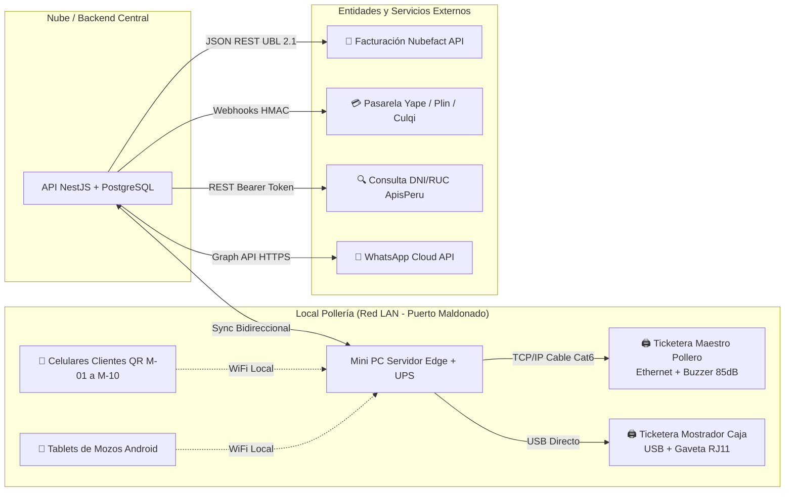

# Especificación Técnica, Arquitectura y Requerimientos Operativos
## Sistema Integral de Gestión Web para Pollería y Brasas (Versión 3.0 - Topología de 1 Piso)

**Fecha:** Septiembre 2026  
**Área de Proyecto:** Ingeniería de Software / Análisis y Diseño de Sistemas  
**Tipo de Sistema:** Web Multi-dispositivo / Edge Computing (Cloud con Resiliencia LAN Local)  
**Estado:** Documento Autónomo y Definitivo de Requerimientos

---

## 1. Topología Física del Negocio (1 Solo Piso - 10 Mesas)

El sistema modela la distribución física y operativa optimizada para un establecimiento de **un solo nivel con 10 mesas**, eliminando la complejidad de tránsito vertical y centralizando la producción en la estación del maestro pollero:

```
┌────────────────────────────────────────────────────────────────────────────────────────┐
│               TOPOLOGÍA DE SALÓN Y PRODUCCIÓN CENTRALIZADA (PISO ÚNICO - 10 MESAS)      │
├──────────────────────────────────────────┬─────────────────────────────────────────────┤
│ SALÓN COMERCIAL Y CAJA (FRONT)           │ ESTACIÓN DEL POLERO Y COCINA (BACK)         │
│                                          │                                             │
│ ┌──────────────────────────────────────┐ │ ┌─────────────────────────────────────────┐ │
│ │ Salón Principal (10 Mesas de Madera) │ │ │ Estación Central del Maestro Pollero    │ │
│ │ - Mesas M-01 a M-10 (QR en Acrílico) │ │ │ - Horno de Brasas Giratorio             │ │
│ │ - Atención con 2 Mozos (Tablets)     │ │ │ - Tina térmica de Papas Fritas listas   │ │
│ └──────────────────────────────────────┘ │ │ - Bandejas de ensaladas y cremas       │ │
│ ┌──────────────────────────────────────┐ │ │ - Mesa de trozado, empaque y despacho   │ │
│ │ Mostrador de Caja y Bebidas          │ │ │ - 🖨️ TICKET. RED CON ALARMA (BUZZER)    │ │
│ │ - PC Táctil Caja + Gaveta RJ11       │ │ └─────────────────────────────────────────┘ │
│ │ - Mini PC Servidor Local Edge + UPS  │ │ ┌─────────────────────────────────────────┐ │
│ │ - Conservadora de Bebidas Heladas    │ │ │ Cocina Interna de Fondo (Reabastece)    │ │
│ │ - 🖨️ Ticketera de Boletas Fiscales   │ │ │ - Maceración y lavado de pollos         │ │
│ └──────────────────────────────────────┘ │ │ - Batería freidora de papas (en bulto)  │ │
│ ┌──────────────────────────────────────┐ │ │ - Almacén seco y congeladora           │ │
│ │ Mostrador Despacho (Llevar/Delivery) │ │ │ (Sin ticketera: surte en tinas al horno)│ │
│ │ - Entrega de pedidos empaquetados    │ │ └─────────────────────────────────────────┘ │
│ └──────────────────────────────────────┘ │                                             │
└──────────────────────────────────────────┴─────────────────────────────────────────────┘
```

---

## 2. Stack Tecnológico Integral

### 2.1. Frontend (Capa de Presentación)
* **Framework:** **Next.js (React) + TypeScript**.
  * **Módulo Comensal (Menú QR):** Desplegado como **PWA (Progressive Web App)** ultraligera. No requiere instalación en App Store ni Google Play; carga en menos de 1 segundo mediante service workers con catálogo en memoria caché local.
  * **Módulo Mozos (Tablets) y Caja (All-in-One Táctil):** Diseñado con componentes táctiles de alta densidad, optimizados para dedos (*touch-friendly* con áreas de toque mínimas de 48px).
* **Diseño y Estilos:** **Tailwind CSS + shadcn/ui**.
* **Gestión de Estado y Sincronización:** **Zustand** (estado local de pedidos) + **TanStack Query** (cache y revalidación de datos del servidor).

### 2.2. Backend (Lógica de Negocio y Servicios)
* **Entorno:** **Node.js (LTS)** con **TypeScript**.
* **Framework:** **NestJS** (arquitectura modular basada en Controladores, Servicios, DTOs e Inyección de Dependencias).
* **Comunicación en Tiempo Real:** **WebSockets (Socket.io)** para eventos instantáneos:
  * Alerta de *"Llamar al mozo"* o *"Pedir cuenta"*.
  * Actualización en vivo del estado de mesas y cocina.
  * Sincronización de platos agotados (Toggle 86).

### 2.3. Base de Datos, Persistencia y Cache
* **Base de Datos Relacional Principal:** **PostgreSQL 16**.
  * Cumplimiento estricto de **ACID** para transacciones de cobro, arqueos y kardex de insumos.
  * Uso de columnas **JSONB** para modificadores dinámicos de platos (presas, tipos de papas, selección de cremas).
* **ORM:** **Prisma** (tipado estricto extremo a extremo).
* **Cache en Memoria y Colas de Tareas:** **Redis + BullMQ**.
  * Gestión de tokens temporales de mesas QR.
  * Procesamiento asíncrono de comandas de impresión y llamadas a APIs externas.

### 2.4. Resiliencia en Local: Edge Gateway (Mini PC en Caja)
* **Hardware:** Mini PC con procesador Intel N100 / Core i3, 16GB RAM, almacenamiento NVMe, conectada por cable Cat6 al router principal.
* **Software:** Agente de impresión ESC/POS y base de datos local embebida (**SQLite / PGLite**) que mantiene la operación en red LAN ante cualquier corte de internet en el local.

---

## 3. Conexiones Externas e Integraciones de Hardware



### 3.1. Facturación Electrónica SUNAT vía PSE/OSE (Nubefact / Bsale)
* **Protocolo:** REST API (JSON).
* **Operación:** Construcción del comprobante fiscal (Boleta, Factura, Nota de Crédito) con cálculo de IGV (18%) e ICBPER (impuesto a bolsas plásticas en delivery).
* **Respuesta:** Almacenamiento de Hash, CDR (Constancia de Recepción de SUNAT), enlace al PDF y generación del código QR tributario impreso en el ticket.
* **Contingencia:** Cola de reintentos con correlativo de contingencia fiscal ante caídas del enlace de internet.

### 3.2. Pasarela de Pagos Digitales para Autoservicio QR (Culqi / Izipay Online)
* **Protocolo:** Checkout embebido + **Webhooks HTTP POST firmados con HMAC**.
* **Soporte:** Billeteras digitales (código de aprobación Yape de 6 dígitos, Plin) y tarjetas de débito/crédito.
* **Flujo Seguro:** El cliente paga en su móvil -> La pasarela valida el cobro y dispara un Webhook al backend -> El backend valida la firma criptográfica -> La comanda se envía a impresión automática.

### 3.3. Consulta Rápida de Identidad (RENIEC / SUNAT)
* **Protocolo:** API REST (ApisPeru o Migo).
* **Utilidad:** Al ingresar DNI en Boleta o RUC en Factura, el sistema autocompleta nombres, razón social y estado tributario (Activo/Habido) en menos de 300 ms en caja.

### 3.4. Hardware de Impresión ESC/POS en Red (2 Ticketeras Físicas Únicas)
* **Protocolo:** Sockets RAW TCP/IP por puerto 9100 sobre cableado Cat6 (Cocina) y USB directo (Caja).
* **Las 2 Únicas Estaciones de Impresión del Restaurante:**
  * **1. Estación Central del Maestro Pollero (Cocina / Brasas):** Ticketera térmica de red Ethernet de 80mm con alarma sonora (**Buzzer** acústico de 85 dB) activado por comando ESC/POS `GS ( A` para cortar el ruido de la campana extractora y avisar al hornero. Imprime la comanda integral con la presa (pecho/pierna), papas y ensalada.
  * **2. Mostrador de Caja:** Ticketera térmica USB de 80mm conectada a la PC de caja y con apertura automática de gaveta de dinero vía pulso eléctrico RJ11. Emite pre-cuentas y comprobantes de pago autorizados por SUNAT con código QR tributario.
  *(Nota: Las bebidas se retiran de la conservadora al lado de caja y las papas las sirve el pollero de su tina térmica; no se requieren impresoras adicionales innecesarias).*

### 3.5. Notificaciones Digitales (WhatsApp Business Cloud API)
* **Protocolo:** Meta Graph API.
* **Utilidad:** Envío del comprobante electrónico en PDF al cliente (reduciendo consumo de papel térmico) y alertas automáticas de despacho de delivery.

---

## 4. Protocolos de Actuación ante Escenarios Operativos Críticos

### 4.1. Alta Concurrencia en Horas Punta
* **Colas Asíncronas en Memoria:** Las comandas entrantes se registran en colas Redis (FIFO) sin bloquear el hilo de ejecución principal ni colapsar la base de datos PostgreSQL.
* **Semáforo y Tiempos de Espera Dinámicos:** El sistema calcula el número de pollos en cola de producción. Si hay más de 12 órdenes pendientes, la carta QR muestra automáticamente una etiqueta informativa: *"Tiempo estimado de horneado: 25 a 35 min"*, reduciendo la ansiedad y quejas de los clientes.

### 4.2. Control de Platos e Insumos Agotados (Protocolo "86'd")
* **Acción en 1 Clic:** Desde la pantalla de caja o administración se activa el switch *"Agotar Insumo"*.
* **Actualización en Tiempo Real:** Mediante WebSockets, el plato o presa (ej. *Pechuga*) cambia al estado deshabilitado (`disabled`, color gris opaco) en todos los teléfonos de los clientes de forma simultánea.
* **Sugerencia de Sustituto:** El sistema sugiere alternativas disponibles (ej. *"Solo disponemos de Pierna con muslo, ¿desea continuar?"*).
* **Validación Atómica en Checkout:** Si un comensal tenía el plato en su carrito antes del apagado, el backend valida la disponibilidad al pulsar *"Confirmar"* e impide el cobro con un mensaje de disculpa amigable.

### 4.3. Experiencia UX para Porciones Adicionales y Pedidos Especiales
* **Sección Destacada de "Acompañamientos y Extras":** Categoría principal en la carta digital para pedir en 1 clic:
  * Porciones de arroz (blanco, chaufa).
  * Porciones de ensalada fresca o cocida adicional.
  * Porciones extras de papas fritas y cremas en pote.
* **Venta Cruzada Inteligente (Cross-Selling):** Al seleccionar un combo o 1/2 pollo, una ventana emergente sutil pregunta: *"¿Deseas acompañar tu pollo con una porción de arroz chaufa o tequeños?"*.
* **Campo de Instrucciones Especiales:** Cuadro de texto por ítem (*"vinagreta aparte"*, *"papas bien doradas"*).
* **Botón de Soporte "Llamar al Mozo":** Si el cliente utiliza el buscador y no encuentra un producto específico, la pantalla despliega un botón directo:  
  `[🛎️ ¿No encuentras lo que buscas? Llamar al Mozo]`  
  El mozo recibe la alerta en su tablet con el mensaje: *"Mesa 3 solicita asistencia por consulta de carta"*.

### 4.4. Erradicación de Fricciones en la Toma de Pedidos
* **Flujos Guiados Obligatorios:** El software bloquea el envío de la orden si no se ha seleccionado la presa (pecho o pierna), el tipo de papas y las cremas deseadas.
* **Impresión Legible e Instantánea:** Cero errores por caligrafía manual ilegible.
* **Control de Concurrencia de Mesas:** El sistema bloquea que dos mozos abran pedidos contradictorios en la misma mesa simultáneamente.

### 4.5. Trazabilidad y Gestión de Reclamos de Clientes
* **Auditoría Temporal de la Comanda:** Cada pedido registra marcas de tiempo auditables:
  1. Hora de envío del pedido.
  2. Hora de impresión en brasas/cocina.
  3. Hora de despacho/cierre.  
  *(Permite comprobar de inmediato si un retraso ocurrió en cocina o en la entrega del mozo).*
* **Anulación Protegida con Rol de Supervisor:** Ningún mozo puede anular un plato servido; se requiere autorización mediante PIN del Administrador, seleccionando el motivo formal (*"Plato devuelto/frío"*, *"Error de comensal"*, etc.).
* **Notas de Crédito Electrónicas:** Emisión automática ante SUNAT si el comprobante ya fue emitido.
* **Libro de Reclamaciones Virtual:** Enlace reglamentario de INDECOPI integrado en el pie del menú QR.

### 4.6. Red, Conectividad y Servicio de WiFi
* **Segmentación de Redes (VLANs en Router Empresarial):**
  * `VLAN_Operaciones` (Red Oculta WPA3): Exclusiva para la Mini PC, tablets de mozos, impresoras de cocina y terminal de caja. Prioridad de tráfico QoS garantizada.
  * `VLAN_Clientes` (Red Abierta con Portal Cautivo): Ancho de banda limitado (máx. 4 Mbps por dispositivo) para evitar saturación de streaming.
* **Portal Cautivo de Marketing:** Para navegar gratis, el cliente registra su WhatsApp o correo, alimentando la base de datos de fidelización para campañas promocionales entre semana.

### 4.7. Evaluación de Pantallas de Gran Formato
* **Mostrador de Caja / Despacho (Menú Board Digital):** **SÍ.** Pantalla TV horizontal de 43" o 50" sobre el mostrador mostrando combos familiares y precios para agilizar la decisión del cliente en fila.
* **Pantalla de Llamado de Pedidos (Takeout):** **SÍ.** Monitor compacto que muestra los números de orden (*"En Preparación"* vs *"Listo para Retirar"*).
* **Área de Brasas / Horno:** **NO.** El calor extremo (50 °C), humo y grasa suspenden la vida útil de pantallas electrónicas. Se mantiene la ticketera térmica con gabinete protector y buzzer acústico.

### 4.8. Resiliencia Energética ante Cortes de Luz
* **Sistema de Alimentación Ininterrumpida (UPS de 1000VA - 1500VA):** Respalda la Mini PC Edge Gateway, el router de comunicaciones y la ticketera de caja, otorgando entre **30 y 45 minutos de energía continua**.
* **Dispositivos Móviles:** Las tablets de los mozos operan de forma autónoma con su batería interna (6-8 horas).
* **Procedimiento de Cierre Preventivo:** Si la interrupción eléctrica supera los 20 minutos, el sistema emite una alarma para cobrar mesas abiertas y guardar los turnos de caja de forma segura.
* **Contingencia Manual SUNAT:** Talonario físico impreso de boletas de contingencia en gaveta para caídas prolongadas.

---

## 5. Matriz Definitiva de Formas de Pago

Modalidades y momentos comerciales de liquidación en el local:

| # | Forma de Pago | Momento de Cobro | Escenario de Uso |
| :-: | :--- | :--- | :--- |
| **1** | **Postpago / Al Consumo** | Al finalizar la comida | Salón tradicional: el cliente consume y pide la cuenta en mesa o caja. |
| **2** | **Prepago / Anticipado** | Previo a la preparación | Mostrador (Takeout) y pedidos QR exprés con pasarela integrada. |
| **3** | **Contra Entrega (COD)** | En la entrega domiciliaria | Delivery propio: cobro en efectivo con cambio exacto o POS móvil. |
| **4** | **Pago Dividido (Split Bill)** | Al solicitar la precuenta | Grupos o amigos: división en montos iguales o por platos consumidos individuales, emitiendo boletas independientes. |
| **5** | **Pago Mixto / Combinado** | En caja al liquidar | Una sola cuenta abonada con dos medios (ej. parte en efectivo y saldo en Yape o tarjeta). |

---

## 6. Estrategia Logística de Delivery en Perú

### 6.1. Comparativa de Canales

```
CANAL PROPIO (Web / WhatsApp) ───► Comisión 0% ───► Repartidor Propio ───► Margen Neto 100%
MARKETPLACES (PedidosYa/Rappi) ──► Comisión 20-30% ► Repartidor App ──────► Margen Reducido
```

### 6.2. Modelo Híbrido Recomendado
1. **Canal Directo (Base de la Rentabilidad):**
   * El cliente pide por la Web del restaurante o enlace de WhatsApp.
   * Cero comisiones a plataformas externas.
   * Entrega realizada por 1 o 2 motorizados propios contratados con tarifa fija por carrera (S/. 5.00 a S/. 7.00 según sector).
   * Módulo de liquidación en software: arquea al final del turno el efectivo cobrado por cada repartidor contra los pedidos entregados.
2. **Apps Externas (Vitrina de Captación):**
   * Se utiliza PedidosYa / Rappi únicamente para captar nuevos comensales de zonas más alejadas.
   * Los precios en la app externa se configuran con un recargo del 15% al 20% para absorber la comisión de la plataforma.
   * El software permite registrar la venta externa para descontar stock de pollos sin mezclar los fondos de caja.

---

## 7. Catálogo Completo de Requerimientos Funcionales (RF-01 al RF-15)

Para fines de desarrollo, codificación y pruebas, a continuación se consolida la lista formal de requerimientos del sistema:

### Módulo 1: Salón y Control de Mesas
* **RF-01 Mapa Gráfico de Salón:** Vista interactiva de mesas del piso único con codificación de colores según estado: *Libre (verde), Ocupada (rojo), Con pedido QR por confirmar (amarillo), Precuenta solicitada (azul), Por limpiar (gris)*.
* **RF-02 Operaciones de Mesas:** Fusión de mesas continuas para grupos grandes, cambio/transferencia de mesa y división de comensales.
* **RF-03 Comanda Móvil para Mozos:** Interfaz en tablet para toma manual de pedidos cuando el cliente prefiera no usar el QR.

### Módulo 2: Autoservicio QR y Comensal
* **RF-04 Acceso por QR Dinámico con Token:** Identificador criptográfico único por mesa para evitar fraudes o pedidos remotos fuera del salón.
* **RF-05 Catálogo Digital Interactivo con Modificadores y Precios Reales:** Selección de presas obligatorias (*Pecho o Pierna*), estilo de papas (*Clásicas, Nativas, Rústicas*), ensaladas (*Clásica, Cocida, Sin ensalada*) y cremas múltiples.
  * **Estructura Tarifaria Oficial (Puerto Maldonado - Base 1/8 a S/. 14.00):**
    * `1/8 Pollo a la Brasa`: **S/. 14.00** *(Opción individual económica con papas y ensalada)*.
    * `1/4 Pollo a la Brasa`: **S/. 24.00** *(Elección forzosa Pecho con Ala o Pierna con Encuentro)*.
    * `1/2 Pollo a la Brasa`: **S/. 45.00** *(Para 2 personas, papas y ensalada)*.
    * `1 Pollo Entero a la Brasa`: **S/. 80.00** *(Familiar 4 cuartos, papas familiares y ensalada grande)*.
    * `Mostrito 1/8 Pollo`: **S/. 18.00** *(1/8 de pollo + arroz chaufa + papas fritas)*.
    * `Mostrito 1/4 Pollo`: **S/. 28.00** *(1/4 de pollo + arroz chaufa + papas fritas)*.
    * `Guarniciones y Bebidas`: Porción extra papas S/. 12.00, ensalada S/. 8.00, gaseosa 500ml S/. 4.50, gaseosa 1.5L S/. 12.00, jarra chicha morada 1L S/. 12.00.
* **RF-06 Asistencia Digital en Mesa:** Botones de *"Llamar al Mozo"* y *"Pedir la Cuenta"* con alerta acústica en tablets de personal.
* **RF-07 Cobro QR con Pasarela Oficial:** Checkout integrado para pagos directos con código Yape de 6 dígitos, Plin y tarjetas vía Webhook HMAC.

### Módulo 3: Cocina, Brasas y Enrutamiento de Comandas
* **RF-08 Comanda Integral en Estación Central del Maestro Pollero (ESC/POS):**
  * Emisión automática de comanda unificada en la ticketera de brasas con activación de alarma sonora (**Buzzer de 85 dB**) cada vez que ingresa una orden.
  * Formato en letra grande y legible destacando: Mesa (M-01 a M-10) o Para Llevar, Presa obligatoria (*Pecho con Ala* o *Pierna con Encuentro*), tipo de papas, tipo de ensalada y cremas.
  * Centralización en el puesto del pollero (quien ensambla el plato completo con las papas calientes de su tina y las ensaladas de su mostrador), eliminando impresoras innecesarias en freidora o barra.
* **RF-09 Gestión de Platos Agotados (Protocolo 86):** Deshabilitación en 1 clic de productos sin stock con actualización en vivo vía WebSockets.

### Módulo 4: Caja, Arqueos y Facturación Fiscal SUNAT
* **RF-10 Control de Turnos y Arqueo Ciego de Caja:** Registro de fondo inicial, control de egresos menores, arqueo ciego al cierre de turno (el cajero no ve el saldo teórico del sistema para evitar cuadres manipulados) y emisión del Reporte Z.
* **RF-11 Facturación Electrónica vía API PSE/OSE (Nubefact):** Emisión instantánea de Boletas, Facturas y Notas de Crédito; validación en línea de DNI y RUC con ApisPeru; y cola de reintentos offline de contingencia.
* **RF-12 Notas de Venta Internas:** Generación de comprobantes de control interno cuando el cliente no solicite comprobante tributario.

### Módulo 5: Delivery, Takeout e Inventario
* **RF-13 Módulo de Clientes Recurrentes y Delivery Propio:** Reconocimiento por teléfono, registro de direcciones y tablero Kanban de despacho (*Pendiente -> En Cocina -> Empaque -> En Ruta -> Entregado*).
* **RF-14 Liquidación de Motorizados:** Cuadre de caja al cierre de turno entre el efectivo recaudado por el repartidor y los pedidos entregados.
* **RF-15 Kardex, Escandallo de Presas y Control de Mermas:**
  * Descuento automático de inventario: 1 Pollo a la Brasa = 1 unidad de insumo; 1/4 Pollo = 0.25 unidad, llevando balance diferenciado de pechos vs piernas.
  * Registro justificado de mermas (sobrecocción, roturas, caídas) con aprobación administrativa.
